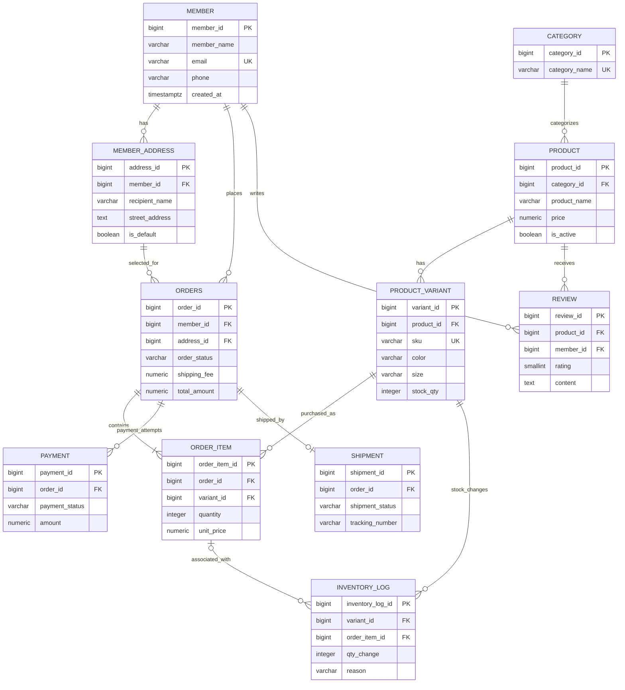

# Database implementation

Canonical executable definition: [`db/001_schema.sql`](../db/001_schema.sql).
PostgreSQL identifiers are lowercase; names correspond to the 11 tables in the proposal.
Primary keys are `bigint GENERATED ALWAYS AS IDENTITY`. All timestamps use `timestamptz`.
Foreign keys preserve historical data with the default NO ACTION deletion behavior.

## Entity relationships

## Data dictionary

All columns are NOT NULL unless marked nullable. See the DDL for exact string lengths and CHECK expressions.

| Table | Columns besides identity primary key |
|---|---|
| `member` | `member_name varchar(100)`, `email varchar(254)` unique, `phone varchar(30)`, `created_at timestamptz` default now |
| `member_address` | `member_id bigint` FK, `recipient_name varchar(100)`, `phone varchar(30)`, `postal_code varchar(20)`, `city varchar(100)`, `district varchar(100)`, `street_address text`, `is_default boolean` default false |
| `category` | `category_name varchar(100)` unique |
| `product` | `category_id bigint` FK, `product_name varchar(200)`, `description text` default empty, `price numeric(12,2)`, nullable `image_url text`, `is_active boolean` default true |
| `product_variant` | `product_id bigint` FK, `sku varchar(100)` unique, `color varchar(50)`, `size varchar(30)`, `stock_qty integer` default 0 |
| `orders` | `member_id bigint` FK, `address_id bigint` composite FK with member, `order_date timestamptz` default now, `order_status varchar(30)` default PENDING_PAYMENT, `shipping_fee numeric(12,2)` default 60, `total_amount numeric(14,2)` default 0 |
| `order_item` | `order_id bigint` FK, `variant_id bigint` FK, `quantity integer`, `unit_price numeric(12,2)` filled by trigger |
| `payment` | `order_id bigint` FK, `payment_method varchar(30)`, `amount numeric(14,2)`, `payment_status varchar(20)`, `created_at timestamptz` default now, nullable `paid_at timestamptz` |
| `shipment` | `order_id bigint` unique FK, `recipient_name varchar(100)`, `phone varchar(30)`, `shipping_address text` (snapshot fields filled by trigger), `carrier varchar(100)`, nullable `tracking_number varchar(100)`, `shipment_status varchar(20)` default PREPARING, `created_at timestamptz` default now, nullable `shipped_at timestamptz`, nullable `delivered_at timestamptz` |
| `review` | `product_id bigint` FK, `member_id bigint` FK, `rating smallint`, `content text` default empty, `created_at timestamptz` default now |
| `inventory_log` | `variant_id bigint` FK, nullable `order_item_id bigint` FK, `qty_change integer`, `reason varchar(20)`, `created_at timestamptz` default now |

Primary keys are `member_id`, `address_id`, `category_id`, `product_id`, `variant_id`,
`order_id`, `order_item_id`, `payment_id`, `shipment_id`, `review_id`, and `inventory_log_id`,
respectively in the table order above.

## Integrity rules

- Prices, shipping, totals, and stock cannot be negative. Quantities must be positive; ratings are 1–5.
- `(product_id, color, size)` and `(order_id, variant_id)` are unique.
- A partial unique index permits at most one default address per member.
- `(address_id, member_id)` references the same pair on `member_address`, rejecting another member's address.
- Only one PAID payment per order; failed payment attempts remain recorded. Payment amount must match
  the order total. Paid payments receive `paid_at`; failed payments do not.
- One shipment per order; one review per member/product. A review requires a DELIVERED order
  containing any SKU of that product. The review does not reference a particular order item.
- RESERVE and RELEASE logs require an order item and the correct quantity sign. RESTOCK and
  ADJUSTMENT logs have no order item. A unique partial index prevents duplicate reserve/release events.
- Order items, payment attempts, and inventory logs are immutable. Orders retain their member,
  address selection, shipping fee, and line-item price snapshots.

## Transactions and concurrency

Each API request opens one psycopg connection/transaction. Successful handlers commit before the
response is transmitted; exceptions roll back the whole request. SQL parameters are bound values;
dynamic column identifiers for PATCH are composed with `psycopg.sql.Identifier` from validated fields.

1. **Order creation:** insert a pending header, then insert items sorted by variant ID. The item BEFORE
   trigger locks the order, reads/locks the active product price, and atomically decrements stock with
   `UPDATE ... WHERE stock_qty >= quantity`. A concurrent buyer waits and rechecks available stock.
   The AFTER trigger inserts a RESERVE log and recomputes the total including shipping. Any failed
   item rolls back the header, all other items, stock, and logs. Identity sequence gaps after rollback
   are normal.
2. **Deferred validation:** a constraint trigger checks at commit that each order has at least one item
   and that the total equals item subtotals plus shipping. This allows temporary empty headers inside
   a transaction while rejecting empty or inconsistent committed orders.
3. **Payment and cancellation:** both lock the same order with `SELECT ... FOR UPDATE`. Only pending
   orders qualify. Payment success updates the order through a trigger. Cancellation releases stock
   in sorted SKU order and records RELEASE logs in its status trigger. A second cancellation cannot
   release stock again. Racing payment/cancel requests produce one valid outcome.
4. **Shipping:** a paid order starts PREPARING. Shipment triggers snapshot the selected address at
   shipment creation, enforce sequential transitions, set timestamps, and synchronize order status.
   A nonempty tracking number is required to ship. The snapshot is immutable after creation.
5. **Manual inventory:** restock and signed adjustment atomically update stock and append a log in
   the same API transaction. Adjustments that would produce negative stock are rejected.
6. **Address defaults:** the API locks the member while replacing a default address. The partial
   unique index remains the final guard against multiple defaults.

`stock_qty` is the authority. Seeded and API-created SKUs also get initial RESTOCK baselines, so
logged changes reconcile with current stock. Manual SQL changes to stock bypass the API's stock-log
pairing; use the stock endpoints when demonstrating adjustments. Direct SQL exercises should use an
explicit transaction, especially when inserting an order header followed by items.

## Reporting and indexes

`product_sales_summary` includes only PAID/PREPARING/SHIPPED/DELIVERED orders. It groups all SKUs by
product, sums quantities, and sums historical unit prices × quantities. Shipping is excluded.
`product_rating_summary` uses LEFT JOIN + GROUP BY to include unrated products with a zero count
and a null average. Joining independent aggregates avoids multiplying sales by review counts.

Indexes support member order history, category products, reverse order-item SKU lookups, product
reviews, low-stock queries, inventory history, and payment attempts. Unique constraints create
additional indexes. Small demo tables can legitimately use sequential scans.

Run the [demonstration SQL](queries.sql) from psql or use the report endpoints. The proposal contains
the broader normalization explanation; price and shipping-address snapshots intentionally preserve
transaction history. No authentication, refunds, discounts, or external payment/logistics services
are implemented.
