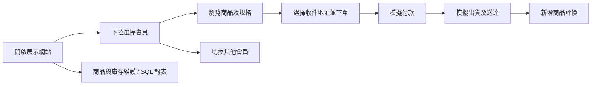
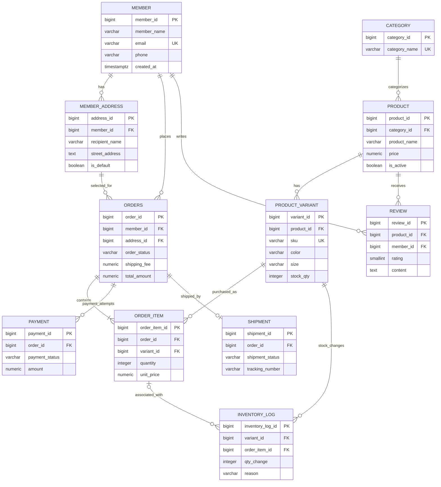

# 鞋子與服飾購物平台：資料庫系統期末專題企劃書

**英文名稱：** Shoes & Apparel Shopping Database Demo  
**專題類型：** 資料庫課堂展示系統（非正式營運網站）  
**技術：** PostgreSQL、Python、FastAPI、psycopg、HTML/CSS/JavaScript  
**小組成員：** ________________________  
**日期：** 2026 年 11 月 23 日

---

## 一、專題摘要

本專題設計並實作一套以鞋子與服飾為主的簡易購物資料庫系統，涵蓋商品分類、尺寸與顏色規格、會員資料、收件地址、訂單、模擬付款、配送、商品評價與庫存紀錄等功能。系統採用 **11 張關聯式資料表**，由 PostgreSQL 管理資料，並以 FastAPI 提供操作介面所需的 API。

本專題的目標是**展示資料庫設計與 SQL 操作**，不是建立可正式上線的購物網站。因此系統**不設登入、密碼、使用者角色、權限區分或應用程式層級的身分驗證**。進入網站後，直接由下拉選單挑選一位已存在的會員作為目前操作對象，即可模擬該會員瀏覽商品、建立訂單、付款、查看訂單及評價。商品維護、庫存調整與報表也直接由展示頁面操作，不另外設管理員角色。

資料庫仍保留主鍵、外鍵、唯一性限制、檢查限制、索引、檢視表及交易處理，重點驗證多表關聯、資料正規化、SQL 查詢及庫存一致性。商品使用**一般固定售價**，不實作折扣、團購活動或跨會員湊單機制。

## 二、專題背景與目標

### 2.1 背景

鞋子與服飾通常有多種顏色、尺寸；每種規格有獨立的 SKU 與庫存。單筆訂單也可能包含多項商品，後續需要記錄付款、出貨、評價等資料。將這些資訊集中於一張表會造成資料重複與更新異常，因此適合使用關聯式資料庫拆分管理。

### 2.2 目標

1. 設計與實作 **11 張資料表**及其 PK、FK 與關聯基數。
2. 建立會員測試資料，讓操作人員透過**會員選擇器**切換操作對象，無須登入。
3. 提供商品查詢、分類、尺寸／顏色規格及各 SKU 庫存。
4. 實作建立訂單、固定售價計算、模擬付款、配送狀態與商品評價。
5. 利用 Transaction 與 Trigger 確保訂單建立、庫存扣減和異動紀錄一致。
6. 使用 SQL 展示 `JOIN`、`GROUP BY`、`VIEW`、`INDEX` 與資料完整性限制。
7. 完成可於課堂現場操作的前端展示介面、API 與測試資料。

### 2.3 專題範圍

| 納入 | 不納入 |
|---|---|
| 會員選擇、會員與地址資料管理 | 註冊／登入、密碼、角色或權限控制 |
| 商品、分類、規格及庫存管理 | 商家進駐、多店家分潤 |
| 訂單、模擬付款、配送及評價 | 真實付款、物流商 API 串接 |
| SQL 查詢、交易、完整性約束及統計報表 | 折扣、優惠券、團購活動及多人湊單 |
| 合成資料與課堂操作展示 | 正式網站的營運與部署安全機制 |

## 三、操作方式與功能需求

### 3.1 單一展示介面：選擇會員後操作

開啟首頁時，系統顯示資料庫內的會員名單。操作人員從下拉選單選取一名會員（例如「測試會員 A」），頁面就以該 `member_id` 顯示購買紀錄與收件地址；若選擇其他會員，畫面隨即切換其資料。

**此選擇器只決定目前展示的會員資料，不是登入，也不進行身分驗證。** 為方便現場展示，所有維護功能皆可從同一頁面進入；本專題不區分顧客介面及管理員權限。

操作流程如下：



### 3.2 功能模組

| 模組 | 展示功能 |
|---|---|
| 會員與地址 | 列出／選擇會員、新增測試會員、查詢／新增其收件地址。 |
| 商品與分類 | 瀏覽商品、按分類或關鍵字查詢、新增／修改商品。 |
| 商品規格 | 查看顏色、尺寸、SKU 及可用庫存。 |
| 訂單 | 以目前選擇的會員下單，查看明細、金額與訂單狀態。 |
| 付款 | 點選「模擬付款成功／失敗」，記錄付款結果。 |
| 配送 | 輸入模擬物流資訊，更新備貨、出貨、送達狀態。 |
| 評價 | 對已購買且送達的商品留下 1～5 星及文字；評價顯示於商品頁面，不區分尺寸與顏色。 |
| 庫存 | 顯示庫存、進貨／調整、下單扣庫存及取消回補紀錄。 |
| 查詢報表 | 顯示商品銷量排行、訂單紀錄、低庫存清單及庫存日誌。 |

### 3.3 技術與資料規則

- 前端、FastAPI 及 PostgreSQL 分層設計；後端以 psycopg 執行參數化 SQL。
- 會員選擇器的值以 `member_id` 傳給後端，**不需要密碼、Token、Session、角色或授權流程**。
- 資料庫仍透過 `NOT NULL`、`UNIQUE`、`CHECK` 和 `FOREIGN KEY` 保障資料正確性。
- 訂單明細與庫存異動必須在同一資料庫交易內完成；錯誤時整筆回滾。
- 本系統僅於課堂受控環境使用，刻意不實作正式網站所需的存取保護。

## 四、技術架構

| 層級 | 技術 | 用途 |
|---|---|---|
| 展示頁面 | HTML / CSS / JavaScript | 會員選擇、商品與訂單操作、報表畫面。 |
| API | Python / FastAPI | 接收操作、執行購物與庫存流程。 |
| 資料庫連線 | psycopg | 執行 SQL、管理交易。 |
| 資料庫 | PostgreSQL 15+ | 11 張資料表、限制、Trigger、View 與索引。 |
| 測試 | 測試資料 SQL / pytest | 準備範例資料、驗證查詢與交易行為。 |

**資料流：** 網頁選擇 `member_id` → 呼叫 FastAPI → psycopg 執行 SQL → PostgreSQL 回傳結果 → 網頁更新。

## 五、資料庫設計

### 5.1 資料表總覽（11 張）

| 資料表 | PK | 主要欄位與用途 |
|---|---|---|
| `MEMBER` | `member_id` | `member_name`、`email`、`phone`、`created_at`；僅儲存會員基本資料，**沒有密碼或角色**。 |
| `MEMBER_ADDRESS` | `address_id` | `member_id` (FK)、收件人、電話、郵遞區號、城市、地區、地址、預設旗標。 |
| `CATEGORY` | `category_id` | 分類名稱。 |
| `PRODUCT` | `product_id` | `category_id` (FK)、商品名稱、說明、一般售價、圖片、是否販售。 |
| `PRODUCT_VARIANT` | `variant_id` | `product_id` (FK)、SKU、顏色、尺寸、庫存數量。 |
| `ORDERS` | `order_id` | `member_id` (FK)、`address_id` (FK)、日期、狀態、運費、總金額。 |
| `ORDER_ITEM` | `order_item_id` | `order_id` (FK)、`variant_id` (FK)、數量、下單時單價。 |
| `PAYMENT` | `payment_id` | `order_id` (FK)、模擬付款方式、金額、狀態及時間。 |
| `SHIPMENT` | `shipment_id` | `order_id` (FK)、收件快照、物流商、追蹤號碼、配送狀態。 |
| `REVIEW` | `review_id` | `product_id` (FK)、`member_id` (FK)、評分、內容、建立時間；評價對象為商品本身。 |
| `INVENTORY_LOG` | `inventory_log_id` | `variant_id` (FK)、`order_item_id` (可空)、異動數量、原因、時間。 |

### 5.2 ER Diagram



> 圖中僅列關鍵欄位，完整型別、限制與 Trigger 以 SQL 建表檔為準。

### 5.3 主要關聯

| 關聯 | 基數 | 說明 |
|---|---|---|
| `MEMBER → MEMBER_ADDRESS` | 1:N | 一位會員可擁有多筆收件地址。 |
| `MEMBER → ORDERS` | 1:N | 一位會員可建立多筆訂單。 |
| `CATEGORY → PRODUCT` | 1:N | 一個分類包含多項商品。 |
| `PRODUCT → PRODUCT_VARIANT` | 1:N | 一項商品有多個顏色／尺寸 SKU。 |
| `ORDERS → ORDER_ITEM` | 1:N | 一筆有商品的訂單可包含多個明細。 |
| `PRODUCT_VARIANT → ORDER_ITEM` | 1:N | 同一 SKU 可在不同訂單中出現。 |
| `ORDERS → PAYMENT` | 1:N | 可記錄多次模擬付款嘗試。 |
| `ORDERS → SHIPMENT` | 1:0..1 | 一張訂單最多一筆配送紀錄。 |
| `PRODUCT → REVIEW` | 1:N | 一項商品可收到多位會員的評價，不區分尺寸與顏色。 |
| `MEMBER → REVIEW` | 1:N | 一位會員可對不同商品留下評價。 |
| `PRODUCT_VARIANT → INVENTORY_LOG` | 1:N | 一個 SKU 對應多次庫存異動。 |

### 5.4 重要完整性限制

- `MEMBER.email`、`CATEGORY.category_name`、`PRODUCT_VARIANT.sku` 具有唯一限制。
- 售價、運費及庫存不可為負數；訂購數量須大於 0；評分為 1～5。
- 同一商品不能重複建立相同的顏色與尺寸組合。
- 每位會員最多一筆預設地址。
- `ORDERS` 使用 `(address_id, member_id)` 複合外鍵，確保訂單地址屬於選定會員；這是**資料關聯正確性**，不是登入權限驗證。
- 每筆訂單最多有一筆 `PAID` 狀態的付款紀錄。
- `SHIPMENT.order_id` 為唯一值；`REVIEW` 以 `UNIQUE(member_id, product_id)` 限制同一會員對同一商品最多一則評價。
- `REVIEW` 以外鍵連到 `PRODUCT` 和 `MEMBER`，新增評價時再查詢該會員是否有相同商品的已送達訂單。
- `ORDER_ITEM.unit_price` 保留下單時的一般售價，避免日後價格變動影響舊訂單。

### 5.5 商品評價（Product-level Review）

`REVIEW` 直接使用 `product_id` 關聯 `PRODUCT`，以 `member_id` 關聯撰寫評價的會員。無論購買哪一種 `PRODUCT_VARIANT`，評價都屬於同一商品，例如白色 41 號和黑色 42 號的休閒鞋共享商品評價。

- 同一會員對同一商品最多建立一則評價，透過 `UNIQUE(member_id, product_id)` 保證。
- 保留「僅限已送達的已購買商品」規則：Trigger 查詢 `MEMBER → ORDERS → ORDER_ITEM → PRODUCT_VARIANT → PRODUCT` 來驗證評價資格，但 `REVIEW` 不儲存 `order_item_id`。
- 商品頁面可使用 `GROUP BY product_id` 搭配 `AVG(rating)`、`COUNT(*)` 顯示平均評分與評論數量。

### 5.6 庫存日誌（Inventory Log）的設計目的

`PRODUCT_VARIANT.stock_qty` 儲存某個 SKU **目前剩餘多少件**；`INVENTORY_LOG` 則保留 **為什麼增加或減少** 的歷史紀錄。庫存日誌不是下單不可或缺的資料表，但有助於課堂展示資料庫交易、Trigger 與跨表追蹤。

| 操作 | `qty_change` | `reason` | 說明 |
|---|---:|---|---|
| 下單預留 3 件 | −3 | `RESERVE` | 與 `ORDER_ITEM` 關聯 |
| 取消未付款訂單 | +3 | `RELEASE` | 返還已預留庫存 |
| 進貨 10 件 | +10 | `RESTOCK` | `order_item_id` 為 `NULL` |
| 盤點修正差額 | 正或負數 | `ADJUSTMENT` | 記錄人工盤點調整 |

每筆日誌的 `variant_id` 指向商品規格，`order_item_id` 為可空，表示一般進貨或盤點不一定對應訂單。下單與取消時，在同一個 Transaction 中同時更新 `stock_qty` 並寫入日誌，任何步驟失敗都回滾。手動進貨／盤點也由後端在單一 Transaction 中完成這兩個操作。

**是否必要：** 若只需要簡單購物 Demo，可刪除 `INVENTORY_LOG`，在訂單建立和取消時直接更新 `stock_qty`，維持 10 張表；本企劃保留它作為展示資料一致性與歷史追蹤的資料庫功能。

**注意：** 本設計的 `stock_qty` 是目前庫存的權威值，日誌記錄開始運作後的異動。若要用 `SUM(qty_change)` 重建完整庫存，還必須先為各 SKU 記錄初始庫存或庫存基準點；只有異動日誌不足以計算最初有多少貨。

## 六、資料庫正規化（Normalization）

### 6.1 1NF

各欄位均儲存單一值。不同尺寸／顏色以多筆 `PRODUCT_VARIANT` 表示；同張訂單的多件商品以多筆 `ORDER_ITEM` 表示，不在欄位中塞入逗號分隔清單。

### 6.2 2NF

各表以單一代理主鍵識別資料。商品描述依賴 `product_id`，規格屬性依賴 `variant_id`，訂購數量依賴 `order_item_id`，避免將商品、規格與訂單明細混合為一張複合主鍵的大表。

### 6.3 3NF

- 商品分類名稱保存於 `CATEGORY`，`PRODUCT` 只透過外鍵參照。
- 商品名稱與現行售價保存於 `PRODUCT`，規格和庫存保存於 `PRODUCT_VARIANT`。
- 訂單明細不重複儲存商品名稱，展示時透過 `JOIN` 取得。
- `ORDER_ITEM.unit_price` 與 `SHIPMENT.shipping_address` 是刻意保留的交易歷史快照，避免舊訂單因商品改價或會員更改地址而失真。

## 七、核心操作流程

### 7.1 選擇會員並查看資料

1. `GET /members` 取得測試會員名單。
2. 從下拉選單選定 `member_id`，畫面載入該會員地址與訂單。
3. 切換會員時重新查詢資料，**不用登入或登出**。

### 7.2 建立訂單與扣除庫存

1. 選定會員、商品 SKU、數量與該會員收件地址。
2. 建立 `ORDERS` 及其 `ORDER_ITEM`。
3. PostgreSQL Trigger 讀取 `PRODUCT.price`，寫入 `ORDER_ITEM.unit_price`。
4. 在同一交易中檢查並扣除 `PRODUCT_VARIANT.stock_qty`，同時新增 `INVENTORY_LOG`。
5. 訂單總額計算為：

   \[
   \text{total\_amount}=\sum_i (\text{quantity}_i\times\text{unit\_price}_i)+\text{shipping\_fee}
   \]

6. 若庫存不足，整筆交易回滾，避免部分完成的訂單。

### 7.3 模擬付款與配送

1. 對 `PENDING_PAYMENT` 訂單執行模擬付款成功或失敗。
2. 新增 `PAYMENT` 紀錄；付款成功時將訂單改為 `PAID`。
3. 從頁面建立 `SHIPMENT`，依序切換 `PREPARING`、`SHIPPED`、`DELIVERED`。
4. 會員可評價自己已購買且送達的 `PRODUCT`。同款商品不同尺寸／顏色共用商品評價，評價不綁定 `ORDER_ITEM`。

### 7.4 取消未付款訂單

1. 選擇未付款訂單執行取消。
2. 使用 `SELECT ... FOR UPDATE` 鎖住訂單。
3. 回補每個 SKU 的數量，並新增原因為 `RELEASE` 的庫存日誌。
4. 將訂單改為 `CANCELLED`；重複取消時拒絕再次回補。

> 示範系統只實作未付款取消與模擬付款；真實退款、拆單配送及外部服務整合不列入範圍。

## 八、API 規劃（無認證版）

所有路由都只供本機／課堂 Demo 使用。**沒有 `/auth/*`、`/login`、`/admin/*` 或 `/members/me`**；會員識別值由選擇器直接提供。

| HTTP | Endpoint | 功能 |
|---|---|---|
| `GET` | `/members` | 取得會員名單，供下拉選擇。 |
| `POST` | `/members` | 新增測試會員資料。 |
| `GET` | `/members/{member_id}/addresses` | 取得該會員的地址。 |
| `POST` | `/members/{member_id}/addresses` | 新增該會員收件地址。 |
| `GET` | `/products` | 商品列表、分類及搜尋。 |
| `GET` | `/products/{product_id}` | 商品詳細資料及 SKU／庫存。 |
| `POST` | `/products` | 新增商品（展示用維護功能）。 |
| `PATCH` | `/products/{product_id}` | 修改商品資料與一般售價。 |
| `POST` | `/orders` | 使用 request body 的 `member_id`、`address_id` 與品項建立訂單。 |
| `GET` | `/members/{member_id}/orders` | 取得選定會員的訂單。 |
| `GET` | `/orders/{order_id}` | 查看訂單明細。 |
| `POST` | `/orders/{order_id}/mock-pay` | 模擬付款。 |
| `POST` | `/orders/{order_id}/cancel` | 取消未付款訂單並回補庫存。 |
| `POST` | `/orders/{order_id}/shipment` | 建立模擬配送紀錄。 |
| `PATCH` | `/shipments/{shipment_id}` | 更新模擬配送狀態。 |
| `GET` | `/products/{product_id}/reviews` | 取得某商品的所有評價與評分。 |
| `POST` | `/products/{product_id}/reviews` | 由 body 傳入 `member_id`、`rating`、`content`，對已購買且送達的商品新增評價。 |
| `POST` | `/variants/{variant_id}/restock` | 增加 SKU 庫存並寫入庫存日誌。 |
| `GET` | `/reports/sales` | 商品銷量與銷售金額。 |
| `GET` | `/reports/inventory` | 低庫存商品及異動清單。 |

建立訂單的示範 JSON：

```json
{
  "member_id": 2,
  "address_id": 3,
  "shipping_fee": 60,
  "items": [
    { "variant_id": 8, "quantity": 1 },
    { "variant_id": 12, "quantity": 2 }
  ]
}
```

上例是 API 格式示意，實際資料須使用種子資料中存在且相符的會員、地址與 SKU 編號。

## 九、SQL 查詢與資料庫展示

### 9.1 會員選擇器資料來源

```sql
SELECT member_id, member_name, email
FROM member
ORDER BY member_id;
```

### 9.2 查詢選定會員的訂單明細（JOIN）

```sql
SELECT o.order_id, m.member_name, p.product_name,
       pv.color, pv.size, oi.quantity, oi.unit_price,
       oi.quantity * oi.unit_price AS subtotal
FROM orders o
JOIN member m ON m.member_id = o.member_id
JOIN order_item oi ON oi.order_id = o.order_id
JOIN product_variant pv ON pv.variant_id = oi.variant_id
JOIN product p ON p.product_id = pv.product_id
WHERE o.member_id = %(member_id)s
ORDER BY o.order_date DESC;
```

### 9.3 商品銷售排行（VIEW）

```sql
SELECT product_name, units_sold, merchandise_revenue
FROM product_sales_summary
ORDER BY merchandise_revenue DESC;
```

`product_sales_summary` 彙總已付款且尚未取消／退款的訂單明細。

### 9.4 商品評分彙總（JOIN + GROUP BY）

```sql
SELECT p.product_id, p.product_name,
       COUNT(r.review_id) AS review_count,
       ROUND(AVG(r.rating), 2) AS average_rating
FROM product p
LEFT JOIN review r ON r.product_id = p.product_id
GROUP BY p.product_id, p.product_name
ORDER BY average_rating DESC NULLS LAST;
```

同款商品不同 SKU 的評價統一列入該商品的評分統計。

### 9.5 低庫存清單

```sql
SELECT p.product_name, pv.sku, pv.color, pv.size, pv.stock_qty
FROM product_variant pv
JOIN product p ON p.product_id = pv.product_id
WHERE pv.stock_qty < 5
ORDER BY pv.stock_qty ASC;
```

### 9.6 原子扣庫存（Transaction）

```sql
UPDATE product_variant
SET stock_qty = stock_qty - %(quantity)s
WHERE variant_id = %(variant_id)s
  AND stock_qty >= %(quantity)s
RETURNING variant_id;
```

若沒有回傳資料列，代表規格不存在或庫存不足。實際建單流程由 Trigger 執行扣庫存、寫入 `INVENTORY_LOG` 與更新訂單總額；FastAPI 負責將整個操作包在同一個 Transaction。

## 十、測試資料與驗收

### 10.1 預計資料量

| 資料類型 | 目標筆數 |
|---|---:|
| 會員 | 10～30 |
| 收件地址 | 15～40 |
| 商品分類 | 3～5 |
| 商品 | 15～25 |
| 商品規格（SKU） | 40～80 |
| 訂單 | 30～60 |
| 訂單明細、付款、配送、評價及庫存日誌 | 依情境產生 |

測試資料由 SQL 或 Python 腳本產生，不涉及真實個人資料或真實金流。

### 10.2 驗收情境

| 情境 | 預期結果 |
|---|---|
| 切換會員選擇器 | 不需登入，顯示不同會員的地址及訂單。 |
| 不同尺寸同款商品 | 各 SKU 獨立計算庫存。 |
| 最後一件商品被同時下單 | 只允許可用庫存範圍內的訂單成立。 |
| 商品修改售價 | 舊訂單的成交單價不變。 |
| 選定會員使用不屬於自己的地址建單 | 複合外鍵阻止錯誤關聯。 |
| 模擬付款失敗後重試 | 保留付款失敗紀錄並可再次付款。 |
| 取消未付款訂單 | 正確回補庫存並記錄 `RELEASE`。 |
| 重複取消同一訂單 | 不重複回補庫存。 |
| 商品尚未送達即評價 | 資料庫拒絕新增評價。 |
| 同一會員再次評價同一商品 | `UNIQUE(member_id, product_id)` 阻止重複新增。 |
| 同款商品不同尺寸的評價 | 合併顯示在同一商品頁面。 |
| 商品銷量排行與低庫存查詢 | 顯示正確的 JOIN／彙總結果。 |

## 十一、開發時程與分工

### 11.1 四週時程

| 週次 | 工作 | 產出 |
|---|---|---|
| 第 1 週 | 需求、ERD、資料字典與 PostgreSQL 環境。 | ERD、DDL 草稿。 |
| 第 2 週 | 建表、外鍵與限制、種子資料、商品／會員查詢 API。 | 可讀取的資料庫與基本頁面。 |
| 第 3 週 | 訂單、扣庫存 Trigger、模擬付款與配送 API。 | 可操作的購物示範。 |
| 第 4 週 | 評價、SQL 報表、測試、專題文件與簡報。 | 完整課堂 Demo。 |

### 11.2 分工建議

- **資料庫：** ERD、DDL、外鍵／限制、Trigger、View、種子資料及查詢。
- **後端：** FastAPI、會員切換查詢、訂單與庫存交易、付款／配送模擬。
- **前端：** 會員選擇器、商品列表、訂單操作畫面及報表展示。
- **共同：** 整合測試、Demo 流程、成果報告與簡報。

## 十二、現場展示與交付成果

### 12.1 建議 Demo 順序

1. 開啟頁面，展示會員下拉選單，選擇「測試會員 A」，不需登入。
2. 瀏覽球鞋商品，選擇顏色、尺碼及數量，建立訂單。
3. 查看訂單明細、總金額，並展示商品 SKU 庫存與日誌的變化。
4. 點選模擬付款成功、模擬出貨及送達，然後在商品頁面留下評價並查看平均星等。
5. 切換至「測試會員 B」，展示不同會員的訂單紀錄。
6. 開啟商品維護及報表頁，新增庫存、查詢低庫存與商品銷量排名。
7. 嘗試超出庫存的下單，展示資料庫拒絕操作且不造成負庫存。

### 12.2 交付成果

- 本企劃書（Markdown）。
- **11 張資料表的 Mermaid ERD** 與資料字典。
- PostgreSQL 建表 SQL（PK、FK、UNIQUE、CHECK、INDEX、VIEW、Trigger）。
- 測試資料與交易測試案例。
- FastAPI 與簡易網頁操作介面。
- 課堂展示流程與期末簡報。

---

**專題定位：** 以能實際操作的鞋子與服飾購物情境，展示關聯式資料庫的設計、查詢、約束及交易一致性。整套系統是**選擇會員即可使用的課堂 Demo**，無登入、無角色、無折扣與團購活動機制。
